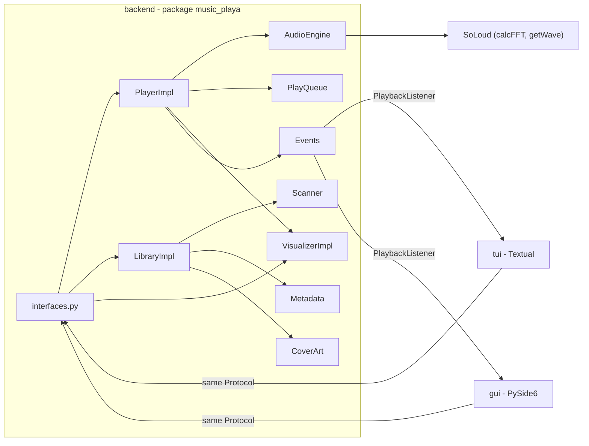

# backend

`music_playa_core` is the shared library. The TUI and the GUI install it in editable mode and import only `music_playa`. They do not call SoLoud, `AudioEngine`, the scanner, or each other's classes.

The current code is a mock. `AudioEngine` does not load `libsoloud`. Playback state lives in memory, the scanner lists files by extension, and the visualizer returns zeros. Swapping in SoLoud later does not change the imports in the TUI or the GUI.

## Interfaces

The public contract is `typing.Protocol` in `interfaces.py`.

| Interface | Responsibility |
|---|---|
| `Player` | play, pause, next, previous, seek, volume, current track, position, queue mode |
| `Library` | list of tracks from the `MUSIC_DIR` directory, metadata, cover art |
| `Visualizer` | `bands()` (`calcFFT`), `wave()` (`getWave`) |
| `PlaybackListener` | callbacks for playback progress and track change |

`__init__.py` exposes `create_app(music_dir)`, which assembles the implementations and returns objects typed as those interfaces.

Both UIs register a `PlaybackListener`. A private adapter in each app only forwards the callback onto its framework's event loop and does not add methods that are not in the protocol.



The diagram is the target shape. In the mock, `MemoryPlayer` does not call `AudioEngine`.

## Function mapping

| Function | Interface called by TUI and GUI | Implementation |
|---|---|---|
| play music | `Player.play()` | `core/player.py` |
| pause playback | `Player.pause()` | `core/player.py` |
| skip song | `Player.next()` | `core/player.py` |
| go to previous song (one back) | `Player.previous()` | `core/player.py` |
| list all songs in working directory | `Library.tracks` | `services/scanner.py`, `core/library.py` |
| get song cover art | `Library.cover(track)` | `services/cover_art.py` |
| get current song info | `Player.current` | `services/metadata.py`, `core/player.py` |
| get current song progress | `Player.position` | `core/audio_engine.py` (`getStreamTime`) |
| change playback volume | `Player.set_volume()` | `core/player.py` |
| jump to specific position | `Player.seek()` | `core/player.py` |
| in order, shuffle, repeat | `Player.mode` | `core/queue.py` |
| audio spectrum visualizer | `Visualizer.bands()`, `Visualizer.wave()` | `services/visualizer.py` (`calcFFT`, `getWave`) |
| playback progress and track change | `PlaybackListener` | `events.py` |

Shared models (`Track`, `PlaybackState`, `PlaybackMode`) live in `models.py`. The "Interface" column is the only API the TUI and GUI use. The "Implementation" column stays inside this package.

The mock scanner accepts `.wav`, `.ogg`, `.mp3`, and `.flac`. It does not read tags. `Library.cover()` returns `None`. `Visualizer.bands()` and `Visualizer.wave()` return 256 zeros. While playback state is playing, `position` advances on a monotonic clock, not on an audio device.

## Stack

- Python 3.15 (`requires-python = ">=3.15"`)
- SoLoud: C library `libsoloud` plus a generated glue file `soloud.py` (no maintained pip package). Not linked by the mock.
- mutagen: tags and cover art. Not a dependency of the mock.
- pytest: `[dev]` extra

The FFT is computed by SoLoud (`calcFFT` / `getWave`). `numpy` is not a core dependency.

### SoLoud

SoLoud is not installed via pip. Two things are needed, kept next to the backend, when the real engine replaces the mock:

1. The shared library `libsoloud`, built with visualization enabled (`Soloud::ENABLE_VISUALIZATION` or `setVisualizationEnable(1)` at runtime).
2. The glue file `soloud.py` generated from the SoLoud sources (the `glue/` directory upstream).

`AudioEngine` will import that glue and load `libsoloud`. The player code does not call the C API directly. Long tracks should use `WavStream` (wav, ogg, mp3, flac). `Wav` decodes the whole file into memory.

## Layout

```
backend/
├── pyproject.toml
├── .venv/                  # dev + pytest
├── src/music_playa/
│   ├── __init__.py         # create_app
│   ├── interfaces.py
│   ├── models.py
│   ├── events.py
│   ├── core/
│   │   ├── audio_engine.py
│   │   ├── player.py
│   │   ├── queue.py
│   │   └── library.py
│   └── services/
│       ├── scanner.py
│       ├── metadata.py
│       ├── cover_art.py
│       └── visualizer.py
└── tests/
```

## Tests

From the repository root, after `scripts/setup.sh`:

```bash
backend/.venv/bin/pytest
```
