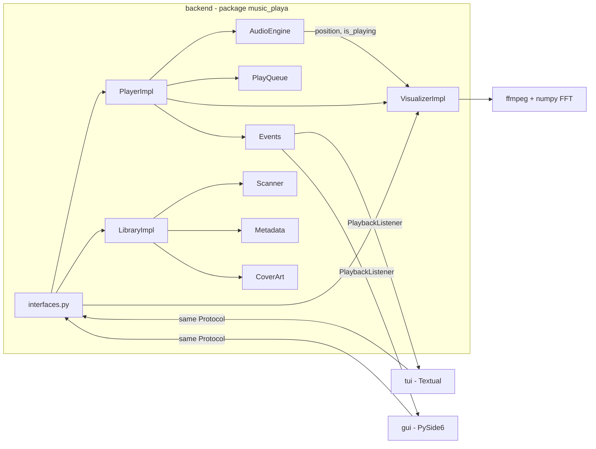

# backend

`music_playa_core` is the shared library. The TUI and the GUI install it in editable mode and import only `music_playa`. They do not call SoLoud, `AudioEngine`, the scanner, or each other's classes.

The current code is a mock. `AudioEngine` does not load `libsoloud`. Playback state lives in memory, the scanner lists files by extension, and the visualizer is computed by `FftVisualizer` (see below). Swapping in SoLoud later does not change the imports in the TUI or the GUI.

## Interfaces

The public contract is `typing.Protocol` in `interfaces.py`.

| Interface | Responsibility |
|---|---|
| `Player` | play, pause, next, previous, seek, volume, current track, playback state (`state`), position, queue mode (`mode`), repeat (`repeat`) |
| `Library` | list of tracks from the `MUSIC_DIR` directory, metadata, cover art |
| `Visualizer` | `bands()` (256 spectrum levels, 0..1), `wave()` (256 samples, -1..1) |
| `PlaybackListener` | callbacks for playback progress and track change |

`__init__.py` exposes `create_app(music_dir)`, which assembles the implementations and returns objects typed as those interfaces.

Both UIs register a `PlaybackListener`. A private adapter in each app only forwards the callback onto its framework's event loop and does not add methods that are not in the protocol.



The diagram is the target shape. In the mock, `MemoryPlayer` does not call `AudioEngine`.

## Function mapping

| Function | Interface called by TUI and GUI | Implementation |
|---|---|---|
| play music | `Player.play()` | `core/player.py` |
| pause playback | `Player.pause()` | `core/player.py` |
| skip song | `Player.next()` | `core/player.py` |
| go to previous song (one back) | `Player.previous()` | `core/player.py` |
| list all songs in working directory | `Library.tracks` | `services/scanner.py`, `core/library.py` |
| get song cover art | `Library.cover(track)` | `services/cover_art.py` |
| get current song info | `Player.current` | `services/metadata.py`, `core/player.py` |
| get current song progress | `Player.position` | `core/audio_engine.py` (`getStreamTime`) |
| change playback volume | `Player.set_volume()` | `core/player.py` |
| jump to specific position | `Player.seek()` | `core/player.py` |
| in order, shuffle | `Player.mode` | `core/queue.py` |
| repeat off, all, one | `Player.repeat` | `core/queue.py`, `core/player.py` |
| audio spectrum visualizer | `Visualizer.bands()`, `Visualizer.wave()` | `services/visualizer.py` (`FftVisualizer`) |
| playback progress and track change | `PlaybackListener` | `events.py` |

Shared models (`Track`, `PlaybackState`, `PlaybackMode`, `RepeatMode`) live in `models.py`. `RepeatMode.OFF` stops after the last track when a track ends and cues the first track again, `ALL` loops the whole list (a single track loops too), and `ONE` restarts the current track when it ends, until the user changes track or stops. A manual `next()` on the last track always returns to the first track (except in shuffle mode, which picks a random track). The "Interface" column is the only API the TUI and GUI use. The "Implementation" column stays inside this package.

The mock scanner accepts `.wav`, `.ogg`, `.mp3`, and `.flac`. It does not read tags. `Library.cover()` returns `None`. While playback state is playing, `position` advances on a monotonic clock, not on an audio device.

## Stack

- Python 3.15 (`requires-python = ">=3.15"`)
- SoLoud: C library `libsoloud` plus a generated glue file `soloud.py` (no maintained pip package). Not linked by the mock.
- mutagen: tags and cover art. Not a dependency of the mock.
- pytest, pytest-cov and mutmut: `[dev]` extra

- numpy: FFT for the visualizer (core dependency)
- ffmpeg: system binary used to decode tracks for the visualizer. If it is missing, the visualizer stays silent and playback is not affected.

### Visualizer

mpv does not expose audio samples, so `FftVisualizer` (`services/visualizer.py`) decodes the current track in a background thread (`ffmpeg -ac 1 -ar 22050 -f f32le`) and takes a 2048-sample window at `AudioEngine.position`. That keeps the spectrum in sync after a seek. The bands are scaled by the engine volume (`AudioEngine.volume`), so quieter playback gives lower bars and volume 0 shows none. It is registered as a `PlaybackListener` in `create_app()` to learn about track changes.

- `bands()` returns 256 log-spaced levels in 0..1 (Hann window, rfft, -70..0 dB). Levels rise instantly and fall at a fixed rate; they fall to 0 when playback is not running.
- `wave()` returns 256 samples of the same window in -1..1, or zeros when not playing.
- Until decoding finishes, or when it fails, both return zeros. `SilentVisualizer` remains as an always-zero implementation.

### SoLoud

SoLoud is not installed via pip. Two things are needed, kept next to the backend, when the real engine replaces the mock:

1. The shared library `libsoloud`, built with visualization enabled (`Soloud::ENABLE_VISUALIZATION` or `setVisualizationEnable(1)` at runtime).
2. The glue file `soloud.py` generated from the SoLoud sources (the `glue/` directory upstream).

`AudioEngine` will import that glue and load `libsoloud`. The player code does not call the C API directly. Long tracks should use `WavStream` (wav, ogg, mp3, flac). `Wav` decodes the whole file into memory.

## Layout

```
backend/
├── pyproject.toml
├── .venv/                  # dev + pytest
├── src/music_playa/
│   ├── __init__.py         # create_app
│   ├── interfaces.py
│   ├── models.py
│   ├── events.py
│   ├── core/
│   │   ├── audio_engine.py
│   │   ├── player.py
│   │   ├── queue.py
│   │   └── library.py
│   └── services/
│       ├── scanner.py
│       ├── metadata.py
│       ├── cover_art.py
│       └── visualizer.py
└── tests/
```

## Tests

From the repository root, after `scripts/setup.sh`:

```bash
backend/.venv/bin/pytest
```

The tests use fakes instead of real devices: a fake `mpv.MPV` for `AudioEngine`, a fake engine for `MemoryPlayer` and mocked `mutagen`/`ffmpeg` calls, so they need no sound card or audio files. Only `create_app` is exercised with the real engine.

Coverage comes from `pytest-cov` (the `[dev]` extra). Line and branch coverage of the `music_playa` package is configured in `[tool.coverage.*]` in `pyproject.toml`, and the report fails below 95%. It is not enabled by default, so plain `pytest` and the mutation run stay fast:

```bash
cd backend && .venv/bin/pytest --cov
cd backend && .venv/bin/pytest --cov --cov-report=html   # report in backend/htmlcov/index.html
```

The current total is 100% (158 tests).

## Mutation testing

`scripts/mutation_backend.sh` runs [mutmut](https://github.com/boxed/mutmut) (mutatest does not support Python 3.15) on the whole `src/` tree and prints the surviving mutants. The configuration is in `[tool.mutmut]` in `pyproject.toml`; every mutant is stopped by the first failing test (`-x`). Mutants are written to `backend/mutants/`, which is ignored by git.

```bash
scripts/mutation_backend.sh
backend/.venv/bin/mutmut show <mutant name>   # from backend/, the diff of one mutant
```

Of 672 mutants, 662 are killed and 10 survive. All the survivors are equivalent, meaning the change does not alter behaviour: an initial `_index` for an empty queue (`-1`, `+1`, `-2` or "always 0" are all treated as "no track"), `_loaded_track = ""` instead of `None` (it is only compared with `is not`), `<=` instead of `<` where the padding would add zero samples, `gain < 0` instead of `<= 0` (zero gain gives zeros anyway), `astype(None)` instead of `astype(float)` (both are `float64`) and `low - 1` in a `max()` whose other argument is never smaller.
